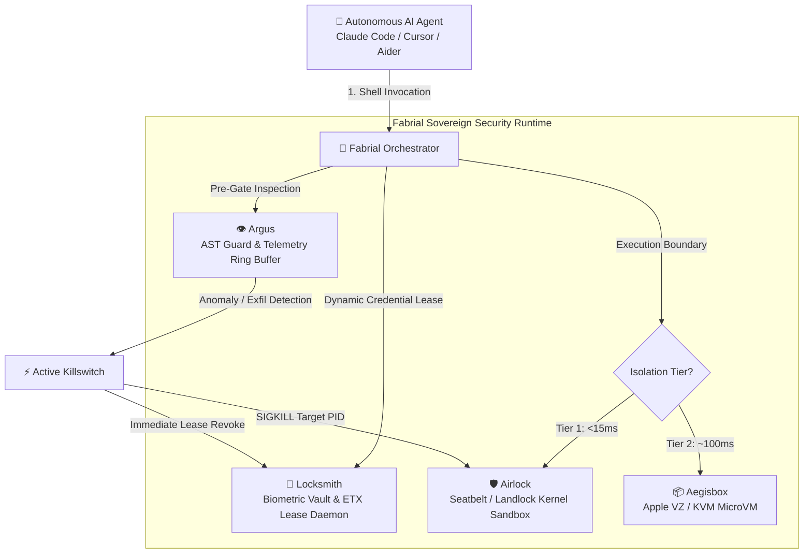

# 💎 Fabrial

> **The Sovereign AI Agent Security Fabric**  
> *Unifying Airlock, Locksmith, Aegisbox, and Argus into an integrated zero-trust runtime for autonomous AI coding agents.*

[](https://golang.org)
[](https://github.com/bonjoski/fabrial)
[-blueviolet.svg)](https://github.com/bonjoski/fabrial)

---

## 📖 The Name & Vision

In Brandon Sanderson's *The Stormlight Archive*, **fabrials** are devices that capture elemental forces within gemstones to manifest extraordinary capabilities—sensing approaching danger (warning fabrials), creating impenetrable barriers (conjoiner fabrials), or projecting precision force.

**Fabrial** brings this paradigm to autonomous software engineering:
AI coding agents (Claude Code, Cursor, OpenCode, Aider, Devin) must possess immense creative capability to edit code, install packages, and run tests. But granting an autonomous agent raw shell access with ambient developer credentials (`~/.ssh`, `~/.aws`, `.env`) on an unfiltered network is an invitation to catastrophic supply chain poisoning or prompt-injection jailbreaks.

**Fabrial harnesses this power**—containing execution in hardware-isolated, kernel-enforced boundaries, streaming audited telemetry without cloud dependencies, and checking out credentials dynamically with sub-second leases that vanish the moment an agent finishes its work.

---

## 🏛️ The Four Pillars



1. **[Airlock](https://github.com/bonjoski/airlock)**: **Kernel Sandbox Engine (Tier 1)**
   - Apple Seatbelt (`sandbox_init`) & Linux Landlock/Seccomp confinement (<15ms overhead).
   - Strict `agent` profile: pinned package registries (npm, PyPI, Go proxy, Crates), blocked ambient credentials (`~/.ssh`, `~/.aws`, `~/.kube`, `.env*`), and `TIOCSTI` terminal injection mitigation.

2. **[Locksmith](https://github.com/bonjoski/locksmith)**: **Ephemeral Secret Vault & Lease Engine**
   - Developer-owned hardware keychain integration (macOS Keychain, Touch ID / Windows Hello).
   - Kernel-attested local IPC (`LOCAL_PEERPID` / `SO_PEERCRED`) with start-time verification to defeat PID recycling.
   - Dynamic ephemeral credential checkout with zero-residual memory scrubbing (`Zero()`) and orphan scavenger daemon.

3. **[Aegisbox](https://github.com/bonjoski/aegisbox)**: **Hypervisor MicroVM Engine (Tier 2)**
   - Hardware-assisted virtualization boundary (Apple Virtualization Framework / Linux KVM).
   - Ephemeral copy-on-write guest environments with rootfs rollback on exit.

4. **[Argus](https://github.com/bonjoski/argus)**: **Telemetry Ring Buffer & Active Killswitch**
   - Sub-millisecond non-blocking telemetry sink (~308µs per event) with zero agent deadlock risk.
   - Normalized CEF & OpenTelemetry logging.
   - Active cascading killswitch: automatically terminates rogue processes (`SIGKILL`) and immediately revokes all active secret leases upon critical tripwire violations.

---

## 🚀 Installation

### Homebrew (macOS / Linux)
```bash
brew tap bonjoski/tap
brew install fabrial
```

### From Source
```bash
git clone https://github.com/bonjoski/fabrial.git
cd fabrial
go build -o bin/fabrial ./cmd/fabrial
sudo mv bin/fabrial /usr/local/bin/
```

---

## ⚡ Usage

### 1. Verify Subsystem Health
Run the diagnostic suite across all 4 security pillars:
```bash
fabrial doctor
```
```text
💎 Fabrial Multi-Pillar Diagnostic Suite
─────────────────────────────────────────────────────────────────
✅ Airlock      [READY   ] Tier 1 Kernel Sandbox Engine
✅ Locksmith    [ONLINE  ] Ephemeral Secret Lease Daemon
✅ Aegisbox     [READY   ] Tier 2 MicroVM Isolation Engine
✅ Argus        [ONLINE  ] SIEM Telemetry & Killswitch Bus
─────────────────────────────────────────────────────────────────
```

### 2. Tier 1 Kernel Confinement (<15ms Overhead)
Run untrusted agent commands under the hardened `agent` profile:
```bash
fabrial exec --profile agent -- npm test
```

### 3. Tier 2 Hypervisor MicroVM Confinement (~100ms Overhead)
Run completely untrusted or hostile scripts inside an ephemeral hardware microVM:
```bash
fabrial exec --profile agent --microvm -- python3 build.py
```

### 4. Ephemeral Secret Leases (No Raw Env Dumps)
Check out secrets dynamically via Locksmith. Credentials exist only in memory inside the sandbox and are revoked immediately on exit:
```bash
fabrial exec --profile agent --lease-secret GITHUB_TOKEN,OPENAI_API_KEY -- npx release-it
```

---

## 🔒 Security Guarantees & Philosophy

- **Zero-SaaS Self-Sovereignty**: 100% of telemetry, enforcement, encryption, and sandboxing runs locally on your workstation. No third-party clouds or external daemons.
- **Fail-Closed by Design**: If Locksmith fails peer attestation, or Aegisbox cannot provision a microVM, or Argus detects process hijacking, the runtime halts execution instantly.
- **Memory Scrubbing**: All cryptographic keys and leased tokens implement explicit volatile memory zeroing before garbage collection.

---

## 📜 License
Apache-2.0 © Ben Skolmoski
