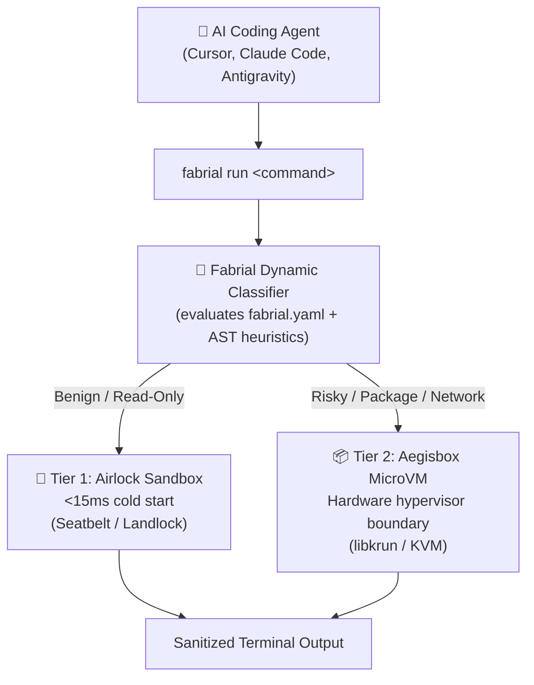

# Recipe: Transparent Command Routing for Autonomous Agents

> **Use Case ID:** `FAB-UC-01`  
> **Target Audience:** Developers, Agent Operators, DevSecOps Engineers  
> **Isolation Tier:** Tier 1 (Airlock Kernel) & Tier 2 (Aegisbox MicroVM)  

---

## 1. Problem Statement

Autonomous AI coding agents (Claude Code, Cursor, Antigravity) generate hundreds of terminal commands per session. Some commands are benign, high-frequency read/lint tasks (`git status`, `gofmt`, `eslint`) that require sub-15ms execution latency. Other commands (`npm install`, `curl | bash`, `make`, `python setup.py`) introduce severe supply chain risks, secret exfiltration vectors, or malicious post-install execution.

Forcing all commands into a heavy microVM introduces unacceptable lag (100–300ms per keystroke/command), while leaving commands unisolated risks host compromise.

---

## 2. When to Use This

Use **Transparent Command Routing** when you want an AI agent to execute arbitrary shell commands without manually classifying whether each command is safe. Fabrial inspects command syntax and AST patterns using `fabrial.yaml` rules:
- **Low-Risk (Linters, formatters, read-only git)**: Automatically dispatched to **Tier 1 (Airlock)** with <15ms latency.
- **High-Risk (Compilers, package managers, network egress)**: Automatically dispatched to **Tier 2 (Aegisbox)** with full microVM hardware isolation.

---

## 3. Architecture & Dataflow



---

## 4. Prerequisites

1. **Fabrial Binary:** `brew install bonjoski/tap/fabrial` (or `fabrial` on `$PATH`).
2. **Tier 1 Engine (Airlock):** Active local kernel boundary (`airlock` on `$PATH`).
3. **Tier 2 Engine (Aegisbox):** Active microVM daemon (`aegisboxd` running on `~/.aegisbox/aegisboxd.sock`).
4. **Health Check:** Run `fabrial doctor` to confirm both engines are ready.

---

## 5. Step-by-Step Recipe

### Step 1: Initialize Project Configuration (Optional)
If your repository does not already have a `fabrial.yaml`, generate one:
```bash
fabrial init
```

### Step 2: Run Commands via `fabrial run`
Execute any command through `fabrial run`:
```bash
# Automatically routed to Tier 1 Airlock (<15ms)
fabrial run eslint src/

# Automatically routed to Tier 2 Aegisbox MicroVM (~100ms hardware isolation)
fabrial run npm install lodash
```

### Step 3: Explicit Tier Overrides (If Needed)
You can force a specific tier or profile via flags:
```bash
# Force Tier 1 kernel sandbox
fabrial exec --profile agent -- npm test

# Force Tier 2 hardware microVM
fabrial exec --profile agent --microvm -- python3 untrusted_script.py
```

---

## 6. Verification & Expected Output

Run `fabrial doctor` to verify dynamic routing hooks:
```bash
fabrial doctor
```
Expected output:
```text
💎 Fabrial Multi-Pillar Diagnostic Suite
─────────────────────────────────────────────────────────────────
✅ Airlock      [READY   ] Tier 1 Kernel Sandbox Engine (<15ms)
✅ Aegisbox     [ONLINE  ] Tier 2 MicroVM Isolation Engine
✅ DynamicRouter[ACTIVE  ] AST heuristics configured (fabrial.yaml)
─────────────────────────────────────────────────────────────────
```

When executing a package manager command, verify the Aegisbox hardware boundary was invoked:
```bash
fabrial run npm install lodash
```
Expected log output:
```text
[fabrial] Command 'npm install lodash' classified as HIGH_RISK (package_manager)
[fabrial] Spawning Tier 2 ephemeral MicroVM workspace...
[fabrial] Execution completed in 118ms. Filesystem delta: +12 files.
```

---

## 7. Security Invariants & Blast Radius

- **Fail-Closed Guarantee:** If the classified isolation tier (e.g. Aegisbox daemon) is unavailable, Fabrial halts execution with exit code `1` rather than falling back to unconfined host execution.
- **Zero-SaaS Privacy:** All classification and AST heuristic parsing occurs 100% on localhost. No command text or environment tokens are sent to external cloud APIs.
- **Workspace Containment:** Writes inside Tier 2 microVMs are contained in Copy-on-Write (COW) memory layers until explicitly approved.

---

## 8. Troubleshooting & Common Pitfalls

- **Issue:** Command fails with `Tier 2 microVM daemon unreachable`.  
  **Remediation:** Start the Aegisbox daemon:
  ```bash
  aegisbox daemon start
  ```
- **Issue:** Linter command is erroneously routed to Tier 2 microVM, causing unwanted latency.  
  **Remediation:** Add the command pattern to the `tier1_allowlist` section of your `fabrial.yaml`:
  ```yaml
  tier1:
    allowlist:
      - "my-custom-linter *"
  ```
