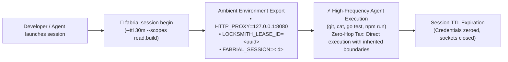

# Recipe: Ambient Session Brokerage (Zero Hop Tax)

> **Use Case ID:** `FAB-UC-02`  
> **Target Audience:** Developers, Autonomous Agent Runners, CI/CD Engineers  
> **Isolation Tier:** Ambient Shell / Non-blocking Brokerage  

---

## 1. Problem Statement

Executing security wrappers synchronously on every single command introduces a "Hop Tax"—a 15–50ms process inception penalty per tool invocation. In high-frequency agentic loops where an AI agent executes dozens of file reads, git checks, and test suites consecutively, wrapping every single subshell command synchronously compounds latency and degrades developer experience.

---

## 2. When to Use This

Use the **Ambient Session Broker** when you want to establish an isolated, credentialed environment once at session startup. Fabrial configures environment variables, loopback proxy addresses, and non-blocking security policies directly in the ambient shell. Individual tools then inherit the security posture natively without incurring wrapper overhead on hot execution paths.

---

## 3. Architecture & Dataflow



---

## 4. Prerequisites

1. **Fabrial Binary:** `brew install bonjoski/tap/fabrial`
2. **Locksmith Daemon:** Required if ephemeral credential injection is enabled (`locksmith daemon status`).
3. **Halfshard Proxy:** Optional loopback secret redactor running on `127.0.0.1:8080`.

---

## 5. Step-by-Step Recipe

### Step 1: Begin an Ambient Session
Start an ambient session with a bounded TTL and explicit capability scopes:
```bash
# Start a 30-minute ambient development session
eval $(fabrial session begin --ttl 30m --scopes read,lint,build)
```

### Step 2: Verify Active Ambient Environment
Inspect the injected environment variables:
```bash
fabrial session env
```
Expected output:
```text
FABRIAL_SESSION_ID=ses_8f1a29d04b3e
FABRIAL_SESSION_TTL=1800s
FABRIAL_SCOPES=read,lint,build
HTTP_PROXY=http://127.0.0.1:8080
HTTPS_PROXY=http://127.0.0.1:8080
```

### Step 3: Run High-Frequency Agent Workflows
Run your autonomous agent (e.g. Claude Code, Cursor terminal, Aider) in this shell. All sub-processes execute at native hardware speed while inheriting outbound proxy filtering and bounded session credentials.

### Step 4: Terminate Session
Upon completion or when switching contexts, close the session:
```bash
fabrial session stop
```

---

## 6. Verification & Expected Output

Check the real-time status of active ambient sessions:
```bash
fabrial session status
```
Expected output:
```text
💎 Fabrial Ambient Session Status
─────────────────────────────────────────────────────────────────
Session ID:   ses_8f1a29d04b3e
Status:       ACTIVE (Expires in 24m 12s)
Active PID:   48912 (zsh)
Inherited:    Locksmith Lease [lck_39bfa10] | Halfshard Proxy [127.0.0.1:8080]
Hop Tax:      0.00ms (Ambient Direct Execution)
─────────────────────────────────────────────────────────────────
```

---

## 7. Security Invariants & Blast Radius

- **Automatic TTL Invalidation:** Once the TTL expires, the ambient session token becomes invalid. Any further requests to Locksmith or Conjoiner sockets fail closed.
- **Process Group Scoping:** Environment variables and leases are scoped strictly to the process tree spawned under the session. Other terminal tabs or developer sessions are isolated.
- **Zero In-Memory Credential Leakage:** Cryptographic leases are stored in-memory in Locksmith and referenced only by opaque handles in the ambient shell.

---

## 8. Troubleshooting & Common Pitfalls

- **Issue:** `eval $(fabrial session begin)` fails with `eval: command not found` or syntax error.  
  **Remediation:** Ensure you run in `bash` or `zsh`. To inspect the export payload directly, run:
  ```bash
  fabrial session begin --ttl 30m --scopes read,build
  ```
- **Issue:** AI Agent opens a new terminal window that doesn't have the ambient session active.  
  **Remediation:** Use `fabrial integrate --global` to automatically source session defaults into your shell profile (`~/.zshrc`).
