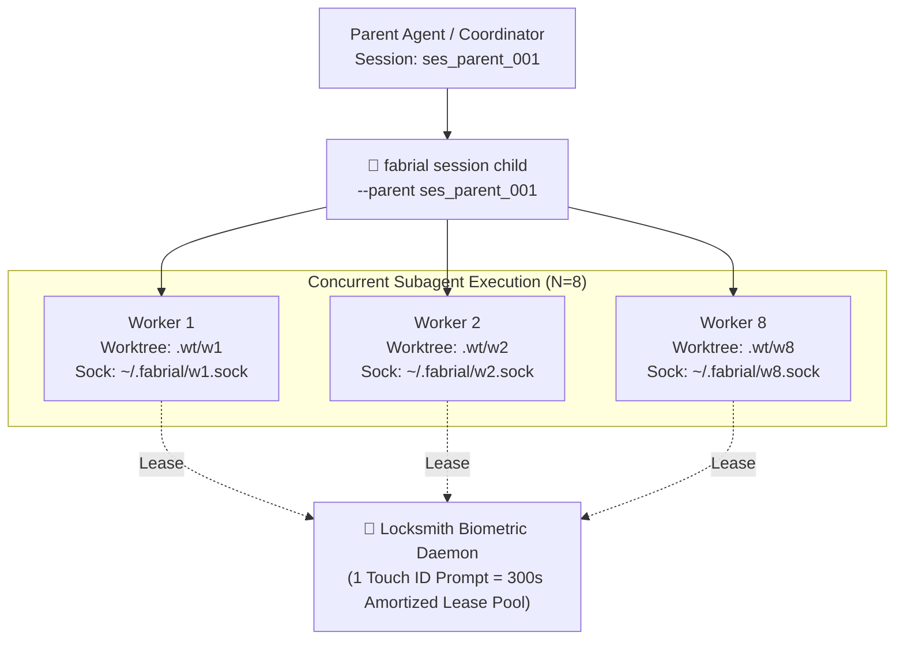

# Recipe: Multi-Agent Sub-Sessions ($N=8$)

> **Use Case ID:** `FAB-UC-03`  
> **Target Audience:** Multi-Agent Orchestrators, Systems Engineers  
> **Isolation Tier:** Scoped Worktrees & Ephemeral Process Trees  

---

## 1. Problem Statement

Modern AI workflows routinely deploy teams or swarms of autonomous subagents (e.g. 8 parallel agents executing refactorings across distinct git worktrees). Running $N=8$ parallel subagents concurrently causes severe host resource and security contention:
1. **Biometric Stalls:** Multiple agents simultaneously requesting credentials trigger 8 separate Touch ID prompts, freezing the desktop.
2. **Socket & Port Collisions:** Parallel agents trying to bind to identical loopback ports or shared Unix domain sockets.
3. **Cache & File Lock Contention:** Parallel agents competing to write to shared build caches (`~/.npm`, `~/.cargo`) or git indices.

---

## 2. When to Use This

Use **Multi-Agent Sub-Sessions** when running coordinated swarms or parallel subagents (e.g. `coordinator` fanning out to `worker-1` through `worker-8`). Fabrial allocates isolated sub-session IDs, derives scoped git worktrees, amortizes biometric authentication, and provides ephemeral socket namespaces.

---

## 3. Architecture & Dataflow



---

## 4. Prerequisites

1. **Fabrial:** Version 1.0+ on `$PATH`.
2. **Git:** Configured with worktree support (`git worktree list`).
3. **Locksmith:** Configured for biometric session lease amortization.

---

## 5. Step-by-Step Recipe

### Step 1: Create the Parent Coordinator Session
```bash
eval $(fabrial session begin --ttl 60m --scopes "swarm:coordinator")
PARENT_ID=$FABRIAL_SESSION_ID
```

### Step 2: Spawn Child Sub-Sessions
For each parallel worker, derive an isolated child session bound to a git worktree:
```bash
# Derive Worker 1 session
CHILD_ENV_1=$(fabrial session child \
  --parent $PARENT_ID \
  --task "refactor-frontend" \
  --worktree ./worktrees/w1)

# Derive Worker 2 session
CHILD_ENV_2=$(fabrial session child \
  --parent $PARENT_ID \
  --task "refactor-backend" \
  --worktree ./worktrees/w2)
```

### Step 3: Run Parallel Worker Tasks
Each worker executes in its own isolated subshell without lock contention:
```bash
# Worker 1 execution
(eval "$CHILD_ENV_1" && cd ./worktrees/w1 && npm test) &

# Worker 2 execution
(eval "$CHILD_ENV_2" && cd ./worktrees/w2 && go test ./...) &

wait
```

---

## 6. Verification & Expected Output

List all active sub-sessions:
```bash
fabrial session list
```
Expected output:
```text
💎 Fabrial Multi-Agent Session Hierarchy
─────────────────────────────────────────────────────────────────
Parent: ses_parent_001 [ACTIVE] (Coordinator, TTL: 52m remaining)
  ├── Sub-Session 1: ses_child_01 [PID 51201] -> ./worktrees/w1
  │   Task: "refactor-frontend" | Tier: Tier 1 Airlock
  ├── Sub-Session 2: ses_child_02 [PID 51204] -> ./worktrees/w2
  │   Task: "refactor-backend"  | Tier: Tier 1 Airlock
─────────────────────────────────────────────────────────────────
Active Subagents: 2 | Socket Collisions: 0 | Biometric Stalls: 0
```

---

## 7. Security Invariants & Blast Radius

- **Biometric Amortization Window:** The parent session conducts a single initial Touch ID verification. Child sessions automatically borrow from the parent lease pool for the duration of the TTL without prompting the user repeatedly.
- **Worktree Isolation:** Writes from Worker 1 cannot mutate Worker 2's workspace. Git lock files (`.git/index.lock`) are partitioned per worktree.
- **Parent Cascade Termination:** If the parent session is terminated or fails a health check, all derived child sub-sessions are immediately halted (`SIGKILL`).

---

## 8. Troubleshooting & Common Pitfalls

- **Issue:** Child subagent fails with `worktree already locked`.  
  **Remediation:** Prune dead worktrees using `git worktree prune` and verify that each subagent is pointed to a unique directory.
- **Issue:** Touch ID prompts repeatedly appear for each child subagent.  
  **Remediation:** Verify that Locksmith is running in daemon mode:
  ```bash
  locksmith daemon status
  ```
