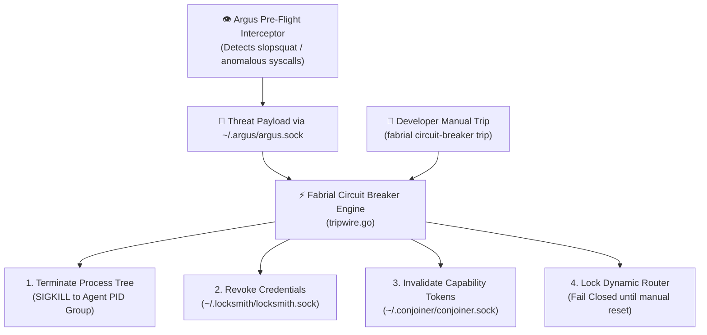

# Recipe: Real-Time Circuit Breaker Emergency Killswitch

> **Use Case ID:** `FAB-UC-04`  
> **Target Audience:** Security Engineers, Autonomous Agent Supervisors, DevSecOps  
> **Isolation Tier:** Host SIEM Bus & Real-Time IPC Tripwire  

---

## 1. Problem Statement

Autonomous agents operate at superhuman speed. If an agent hallucinates a malicious package name (slopsquatting), downloads a compromised dependency, or executes an untrusted script that initiates port scanning or secret scraping, an immediate killswitch is required. 

Traditional post-mortem security alerts notify developers minutes after exfiltration has already occurred. Fabrial provides a real-time circuit breaker bus that intercepts and terminates compromised process trees in milliseconds.

---

## 2. When to Use This

Use the **Circuit Breaker Killswitch** as an automated fail-closed safety net for all autonomous agent executions. Fabrial connects to the local Argus SIEM socket (`~/.argus/argus.sock`). When a threat is detected or when an operator manually hits the emergency stop:
- The target process tree is sent `SIGKILL`.
- Ephemeral credentials checked out in Locksmith are revoked immediately.
- DPoP delegation tokens in Conjoiner are invalidated.
- All pending agent tool calls are aborted.

---

## 3. Architecture & Dataflow



---

## 4. Prerequisites

1. **Fabrial:** Daemon or CLI listening on host.
2. **Argus Socket:** Active at `~/.argus/argus.sock` (optional for automatic tripping).
3. **Locksmith Socket:** Active at `~/.locksmith/locksmith.sock` (for automated credential revocation).

---

## 5. Step-by-Step Recipe

### Step 1: Check Current Circuit Breaker State
```bash
fabrial circuit-breaker status
```
Expected output:
```text
💎 Fabrial Circuit Breaker Status
─────────────────────────────────────────────────────────────────
State:          CLOSED (Normal Operation)
Tripwire Bus:   ONLINE (~/.argus/argus.sock connected)
Active Leases:  2 tracked
Last Trip Event: None
─────────────────────────────────────────────────────────────────
```

### Step 2: Simulate or Trigger Manual Emergency Stop
If you observe anomalous agent behavior or want to verify the tripwire:
```bash
fabrial circuit-breaker trip --reason "Manual operator kill: suspicious network egress"
```

### Step 3: Observe Process Teardown & Fail-Closed State
All ongoing `fabrial run` or `fabrial exec` instances immediately terminate with exit code `137` (`SIGKILL`):
```text
[fabrial] 🚨 CIRCUIT BREAKER TRIPPED! Reason: Manual operator kill: suspicious network egress
[fabrial] Dispatched SIGKILL to process tree (PID 51201)
[fabrial] Revoked 2 active Locksmith credential leases.
[fabrial] Invalidation broadcast sent to Conjoiner.
```

### Step 4: Investigate & Reset the Circuit Breaker
After reviewing logs and isolating the compromised script:
```bash
fabrial circuit-breaker reset
```

---

## 6. Verification & Expected Output

Attempting to run any command while the circuit breaker is tripped fails closed immediately:
```bash
fabrial run ls
```
Expected output:
```text
[fabrial] ERROR: Circuit breaker is in TRIPPED state. Execution blocked.
[fabrial] Run 'fabrial circuit-breaker reset' after remediating the anomaly.
```

---

## 7. Security Invariants & Blast Radius

- **Fail-Closed Locking:** Once tripped, no command can execute through Fabrial until an explicit human operator executes `fabrial circuit-breaker reset`.
- **Zero Orphaned Subprocesses:** Fabrial tracks process group IDs (`PGID`) ensuring that child processes and background daemons spawned by the agent are killed cleanly.
- **Cryptographic Credential Invalidation:** Leases are revoked at the Locksmith daemon level, meaning any token already stored in RAM by the agent is immediately rejected by local proxies.

---

## 8. Troubleshooting & Common Pitfalls

- **Issue:** Circuit breaker trips unexpectedly during dependency installation.  
  **Remediation:** Inspect Argus diagnostic logs to identify which package triggered the alert:
  ```bash
  argus audit --last 5m
  ```
- **Issue:** `fabrial circuit-breaker reset` refuses to reset.  
  **Remediation:** Ensure the offending process is dead and pass `--force` if the Argus alert has been resolved:
  ```bash
  fabrial circuit-breaker reset --force
  ```
