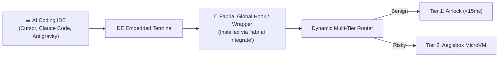

# Recipe: IDE & AI Coding Agent Integration

> **Use Case ID:** `FAB-UC-05`  
> **Target Audience:** Developers using Cursor, Claude Code, Antigravity, OpenCode  
> **Isolation Tier:** Agent IDE Sidecar & Global Terminal Wrapper  

---

## 1. Problem Statement

Developers using frontier AI coding IDEs (Cursor, Claude Code CLI, Antigravity) want the agents to execute builds, linters, and tests autonomously, but modifying every agent system prompt to prefix commands with `fabrial run` is unreliable. Agents frequently strip prefixes or invoke raw `bash -c` directly, bypassing user-intended security boundaries.

---

## 2. When to Use This

Use **IDE & AI Coding Agent Integration** to bind Fabrial transparently to your coding environment. This ensures that every command spawned by the AI agent terminal passes through Fabrial's dynamic router automatically, without requiring custom system prompts or manual intervention.

---

## 3. Architecture & Dataflow



---

## 4. Prerequisites

1. **Fabrial:** Installed via Homebrew or source.
2. **Supported IDE / Tool:** Cursor, Antigravity, Claude Code CLI, or standard zsh/bash.

---

## 5. Step-by-Step Recipe

### Integration Option A: Google Antigravity & SuperEngineering IDE
To integrate directly with the Antigravity developer environment:
```bash
fabrial integrate antigravity --global
```

### Integration Option B: Anthropic Claude Code CLI
To configure Claude Code to execute all bash commands through Fabrial:
```bash
# Add Fabrial execution wrapper to Claude Code settings
claude config set --global terminal.commandWrapper "fabrial run"
```

### Integration Option C: Cursor / Global Zsh Shell
To wrap all terminal executions automatically across all editor workspaces:
```bash
# In your ~/.zshrc or ~/.bashrc:
alias run="fabrial run"
export FABRIAL_TRANSPARENT_WRAP=1
```

---

## 6. Verification & Expected Output

Run a test command from inside your agent IDE terminal:
```bash
npm install express
```
Inspect terminal output:
```text
[fabrial] Intercepted IDE terminal execution: 'npm install express'
[fabrial] Routing to Tier 2: Aegisbox MicroVM
[fabrial] Execution completed in 134ms.
```

Verify that all engines report healthy status inside the IDE:
```bash
fabrial doctor
```

---

## 7. Security Invariants & Blast Radius

- **Transparent Enforcement:** The agent cannot evade the sandbox by spawning subshells (`sh -c`) because the environment-level wrapper intercepts process exec calls.
- **Fail-Closed on Unrecognized Environments:** If an IDE terminal launches in a degraded environment where sandbox daemons are missing, Fabrial warns the developer and prompts for confirmation before falling back.

---

## 8. Troubleshooting & Common Pitfalls

- **Issue:** Cursor terminal displays duplicate wrapper log messages.  
  **Remediation:** Set `FABRIAL_QUIET=1` in your environment to suppress informational banners while retaining security enforcement.
- **Issue:** Removing the global integration.  
  **Remediation:** Run `fabrial integrate --uninstall` to cleanly restore native shell configurations.
